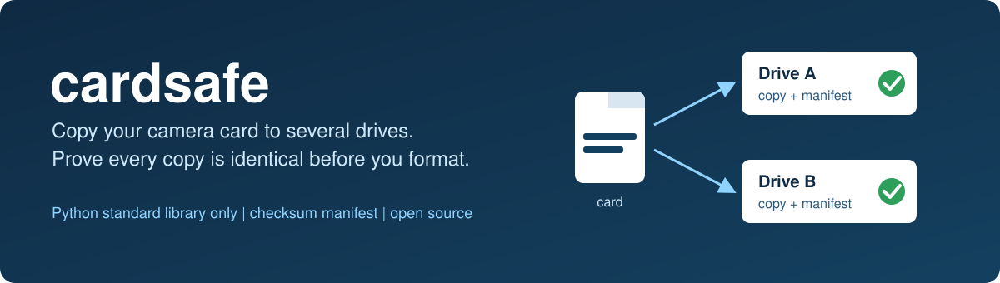
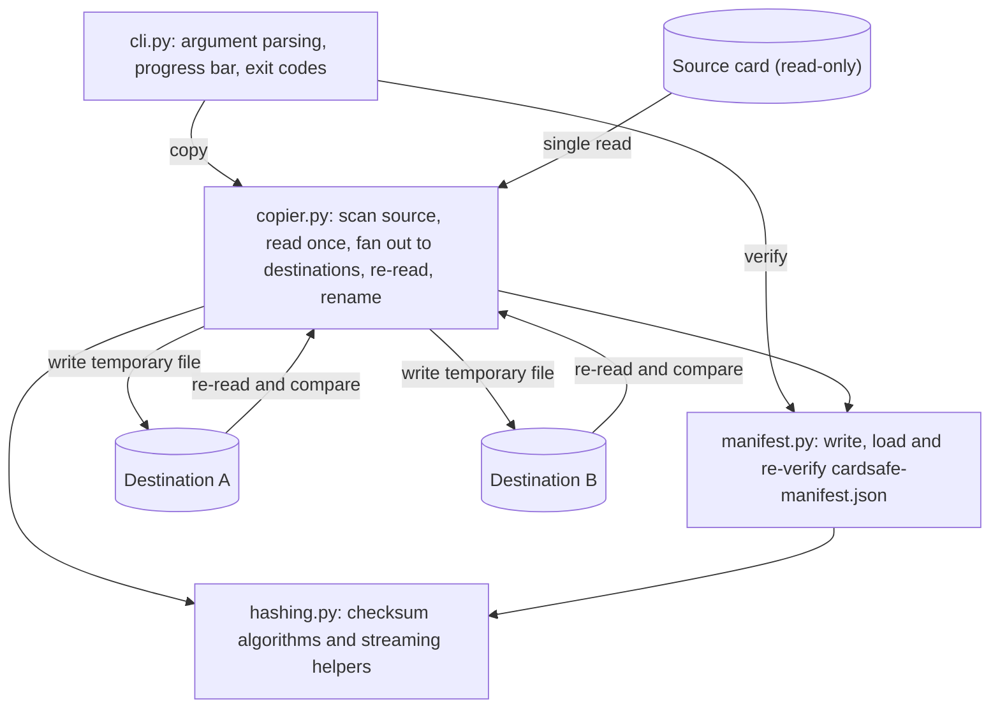

<div align="center">



<br>

[](https://pypi.org/project/cardsafe/)
[](https://pypi.org/project/cardsafe/)
[](LICENSE)
[](pyproject.toml)
[](pyproject.toml)
[](#limitations)

**Copy a memory card to one or more drives, re-read every copy, and keep a checksum manifest you can check again years later.**

[Why](#why-cardsafe) |
[Features](#features) |
[Demo](#demo) |
[Quick start](#quick-start) |
[Usage](#usage) |
[Architecture](#architecture) |
[Manifest](#manifest-format) |
[Comparison](#how-it-compares-with-paid-tools) |
[Limitations](#limitations) |
[Tests](#tests) |
[Roadmap](#roadmap)

</div>

---

> **Read this first.** cardsafe is new and has never been run on a real camera card. Until you have confirmed a second, later verification of your copies, **keep the original card intact and do not format it.** See [Limitations](#limitations).

## Why cardsafe

If you shoot photos or video, the card in your camera is, for a while, the only copy of your work. Dragging the files into a folder with a file manager feels safe, but the file manager never tells you whether what landed on the drive is identical to what was on the card. A flaky cable, a failing drive or an interrupted write can silently damage a file, and you find out weeks later when a clip will not open, often after the card has been reused.

Professional crews solve this with an *offload* step: copy to two places at once, compare checksums, keep a report. cardsafe brings that routine to a small, free, command-line tool whose source you can read in an afternoon.

## What it does

1. You point it at a folder (your card, mounted as a drive) and at one or more destination folders.
2. It reads each file from the card **once**, computes a checksum while reading, and writes the data to every destination at the same time.
3. It then reads every copy back and compares its checksum with the one computed from the card. Only a copy that matches is given its final file name.
4. It writes a `cardsafe-manifest.json` and a human-readable `cardsafe-report.txt` in each destination, so you can re-verify the copies at any later date with `cardsafe verify`.

The card is only ever opened for reading. cardsafe never deletes, moves or formats anything on it.

## Features

Everything below is exercised by the automated tests in [`tests/`](tests) (see [Tests](#tests)); the caveats about real hardware are in [Limitations](#limitations).

- **Several destinations in one pass.** The source file is read once and fanned out to every destination. If one drive fails (full, unplugged), it is reported as an error and the others still complete.
- **Checksum verification of every copy.** Algorithms: `sha256` (default), `sha1`, `md5`, `blake2b`, and `xxh64` if the optional `xxhash` package is installed.
- **Verified before it counts.** Files are written under a temporary `.cardsafe-part` name and renamed only after the re-read matches. A copy that does not match is deleted from the destination (never from the card) and reported as `failed`.
- **Resume.** Re-run the same command after an interruption: identical files are skipped (after hashing both sides), missing files are copied, stale partial files are replaced.
- **No silent overwrite.** An existing file with different content is reported as a `conflict` and left alone unless you pass `--force`.
- **Re-verify later.** `cardsafe verify <folder>` re-hashes everything listed in the manifest and reports `ok`, `missing`, `size-mismatch`, `hash-mismatch` or `invalid-path`. `--strict` also flags files that are not in the manifest.
- **Dry run and JSON output.** `--dry-run` shows the plan and writes nothing; `--json` prints the full report for scripts.
- **Safety checks.** Refuses a destination inside the source (or the reverse), duplicate destinations, unsafe folder templates and manifest paths that try to escape the folder (`..`, absolute paths); `verify` does not follow symbolic links.
- **Clear exit codes.** `0` success, `1` a copy, verification or conflict failed, `2` usage or setup error, `130` interrupted.
- **Zero dependencies, no network.** Pure Python standard library. No telemetry, no account, no AI.

## Demo

This is real output from the tool, not a mock-up. A small stand-in "card" (three 3 MB files named like Canon raw photos and one 6 MB video, filled with random data) was copied to two destination folders, then verified. After that, one byte of one file in the second destination was flipped on purpose to show that `verify` notices. The only edit made for this README is that the long temporary folder path of the test run was shortened to `X:\` (the tool prints the full resolved path of each destination).

```text
> cardsafe copy card RAID_A RAID_B
4 file(s), 15500000 bytes, algorithm sha256
  copied                 DCIM/100CANON/IMG_0001.CR3 -> X:\RAID_A\2026-11-18_card
  copied                 DCIM/100CANON/IMG_0001.CR3 -> X:\RAID_B\2026-11-18_card
  copied                 DCIM/100CANON/IMG_0002.CR3 -> X:\RAID_A\2026-11-18_card
  copied                 DCIM/100CANON/IMG_0002.CR3 -> X:\RAID_B\2026-11-18_card
  copied                 DCIM/100CANON/IMG_0003.CR3 -> X:\RAID_A\2026-11-18_card
  copied                 DCIM/100CANON/IMG_0003.CR3 -> X:\RAID_B\2026-11-18_card
  copied                 DCIM/100CANON/MVI_0004.MP4 -> X:\RAID_A\2026-11-18_card
  copied                 DCIM/100CANON/MVI_0004.MP4 -> X:\RAID_B\2026-11-18_card
OK: copied=8
exit code: 0

> cardsafe verify RAID_A\2026-11-18_card
OK: 4/4 files verified (sha256)
exit code: 0

> (simulate bit rot: flip one byte in RAID_B\2026-11-18_card\DCIM\100CANON\IMG_0002.CR3)

> cardsafe verify RAID_B\2026-11-18_card
  hash-mismatch  DCIM/100CANON/IMG_0002.CR3
FAILED: 3/4 files verified (sha256)
exit code: 1
```

The `cardsafe-manifest.json` written by this run begins like this (see [Manifest format](#manifest-format)):

```json
{
  "format": "cardsafe-manifest",
  "version": 1,
  "tool": "cardsafe 0.1.0",
  "created": "2026-11-18T18:21:10Z",
  "algorithm": "sha256",
  "source_name": "card",
  "files": [
    {
      "path": "DCIM/100CANON/IMG_0001.CR3",
      "size": 3200000,
      "hash": "43057f63063a58933c946f3c74526848debdab3afa806f99a6531a2abee5c6af",
      "mtime": 1795026061
    },
```

## Quick start

You need Python 3.10 or newer (developed and tested with 3.12). 

Install from PyPI:

```bash
pip install cardsafe
cardsafe --version
```

Or install from a clone of this repository:

```bash
git clone https://github.com/Emincanozen/cardsafe.git cardsafe
cd cardsafe
python -m venv .venv
# Windows:      .venv\Scripts\activate
# macOS/Linux:  source .venv/bin/activate
pip install .
python -m unittest discover -s tests
cardsafe --version
```

Then offload a card to two drives and verify the result:

```bash
cardsafe copy /path/to/card /path/to/drive_A /path/to/drive_B
cardsafe verify /path/to/drive_A/<folder-created-by-copy>
```

Optional: `pip install ".[xxhash]"` adds the `xxh64` algorithm. You can also run without installing: `PYTHONPATH=src python -m cardsafe ...` (in Windows PowerShell: `$env:PYTHONPATH="src"; python -m cardsafe ...`).

## Usage

```text
cardsafe copy <source> <dest> [<dest> ...] [options]
cardsafe verify <directory> [--strict] [--json] [--quiet]
```

`copy` creates `<dest>/<date>_<name>/` in every destination (for example `2026-11-18_card`), copies every regular file into it, verifies, and writes the manifest and report there.

| `copy` option | Meaning |
|---|---|
| `--algo {sha256,sha1,md5,blake2b,xxh64}` | Checksum algorithm. Default `sha256`. `xxh64` is listed only when `xxhash` is installed. |
| `--folder TEMPLATE` | Sub-folder created inside each destination. Fields: `{date}` `{time}` `{datetime}` `{name}` (source folder name). Default `{date}_{name}`. Use `""` to copy straight into the destination. Use a template without `{date}`/`{time}` (for example `--folder {name}`) if you might resume on another day. |
| `--force` | Overwrite destination files whose content differs. Without it they are reported as conflicts and left untouched. |
| `--dry-run` | Print the plan; create and write nothing. |
| `--json` | Print the full report as JSON on stdout. |
| `--quiet` | No progress bar; summary printed only on failure. |

**Resume and collisions.** Re-running the same command after an interruption skips files that are already present and identical, copies the missing ones and overwrites stale `.cardsafe-part` leftovers. When a destination folder already has a manifest made with the same algorithm, the new run is merged into it, so entries for earlier verified files are kept. Each destination fails independently.

## Architecture



For each file, `copy` reads the source in 4 MiB chunks, hashes them, and writes each chunk to a temporary `.cardsafe-part` file on every destination. When the file is complete, each temporary file is read back and hashed; if the digest equals the source digest the file is renamed into place, otherwise it is deleted and reported as `failed`. After all files are done, a manifest and a report are written into each destination folder. `verify` later repeats the "read back and compare" step against the manifest.

## Manifest format

`cardsafe-manifest.json` is UTF-8 JSON, `version` 1:

| Field | Meaning |
|---|---|
| `format`, `version` | Always `"cardsafe-manifest"` and `1`. |
| `tool` | Tool name and version that wrote the file. |
| `created` | UTC time of writing, ISO 8601. |
| `algorithm` | Checksum algorithm used for every `hash` below. |
| `source_name` | Name of the source folder. |
| `files[].path` | Path relative to the manifest's folder, always with `/`, never absolute and never containing `..` (such entries are rejected by `verify`). |
| `files[].size` | Size in bytes. |
| `files[].hash` | Lowercase hex digest of the file content. |
| `files[].mtime` | Source modification time in whole seconds (informational; copies keep the modification time). |

Only files verified on that destination are listed. A file at the card root that is itself called `cardsafe-manifest.json` or `cardsafe-report.txt` is copied with a `.source` suffix so it cannot collide with cardsafe's own files. This is cardsafe's own simple format; it is **not** an ASC-MHL file.

## How it compares with paid tools

Commercial offload applications such as Hedge, ShotPut Pro, Silverstack or OffShoot are mature products. This is a qualitative comparison from general knowledge; I have not benchmarked any of them, and I give no prices because I have not verified current ones.

| | cardsafe | Typical commercial offload apps |
|---|---|---|
| Copy to several destinations with checksum verification | yes | yes |
| Resume an interrupted offload | yes (re-run the command) | generally yes |
| Graphical interface | **no** (command line) | yes |
| Camera-aware metadata, thumbnails, PDF reports | **no** | often yes |
| Industry-standard manifests (for example ASC-MHL) | **no** (own JSON format) | often yes |
| Tuned speed on very large cards | **no** (plain Python, lock-step writes) | optimised |
| Track record on real productions | **none yet** | years |
| Source you can read and audit | yes (about 800 lines of Python) | no |
| Cost | free (MIT licence, see [License](#license)) | paid |

If a lost card would be a financial disaster, use a mature commercial tool with support. cardsafe is for people who want a transparent, auditable, free tool, or a building block for their own scripts.

## Limitations

> **Keep the card intact** until you have run `cardsafe verify` on your copies a second time, ideally after unplugging and re-connecting (or rebooting) the drives. Do not format the card on the strength of this tool alone.

- **Never tested on a real memory card or real camera files.** All testing used folders of generated data on an internal drive.
- **Only tested on Windows with Python 3.12.** The code is written to be portable, and a GitHub Actions workflow in `.github/workflows` is set up for Linux, macOS and Windows with Python 3.10, 3.12 and 3.13, but no results from other platforms or versions are claimed here.
- **The re-read may come from the operating system's cache.** Verification reads each copy back through the normal file API, so the OS can answer from RAM instead of the physical disk and hide a faulty write. A later `cardsafe verify` (after re-mounting or rebooting) is the stronger check. Dropping the cache before verification is not implemented.
- **Windows paths longer than 260 characters are not handled specially.** Windows-reserved or invalid file names (`CON`, `NUL`, trailing dots, ...) are reported as errors rather than copied.
- **The manifest is cardsafe's own JSON, not MHL or ASC-MHL.** It maps onto those formats but is not accepted by tools that require them.
- **`--force` reads the source twice** for a file it has to overwrite: once for the normal pass and once more for the overwrite.
- **Symbolic links and non-regular files are not copied** (they are listed in the report). Empty folders are not recreated. Permissions, extended attributes and creation times are not preserved; only the modification time is.
- **A card that returns consistently corrupted data cannot be detected**, because the source checksum is computed from what the card returns.
- **Speed.** Chunks are written in lock-step, so the slowest destination sets the pace; expect lower throughput than native tools on very fast media.
- On case-insensitive destinations, a file whose name differs only by case from a different existing file is reported as an error and is never overwritten, even with `--force`.
- Provided without warranty (see [LICENSE](LICENSE)).

## Tests

```bash
python -m unittest discover -s tests
```

The tests use only temporary directories and the standard library. Last real run, from a clean copy of this repository installed with `pip install .` into a fresh virtual environment (Windows, Python 3.12):

```text
> python -m unittest discover -s tests
Ran 35 tests in 8.778s

OK
```

They cover multi-destination copy and manifests, a source left untouched, corruption detected during copy and by a later `verify`, resume, conflicts and `--force`, unsafe folder templates and manifest paths, symbolic links, interruption cleanup, Windows name rules and exit codes.

## Roadmap

Ideas, not promises:

- Run and record the first tests on real cards and on Linux and macOS (a workflow for this is included in `.github/workflows`).
- Drop the OS cache (or use direct I/O) before the verification read.
- Optional ASC-MHL export.
- Overlap source reads with destination writes and hash in parallel for speed.
- Long-path support on Windows.

## Contributing

Issues and pull requests are welcome: see [CONTRIBUTING.md](CONTRIBUTING.md). Security problems go through [SECURITY.md](SECURITY.md). Changes are listed in [CHANGELOG.md](CHANGELOG.md).

## License

MIT, see [LICENSE](LICENSE).
